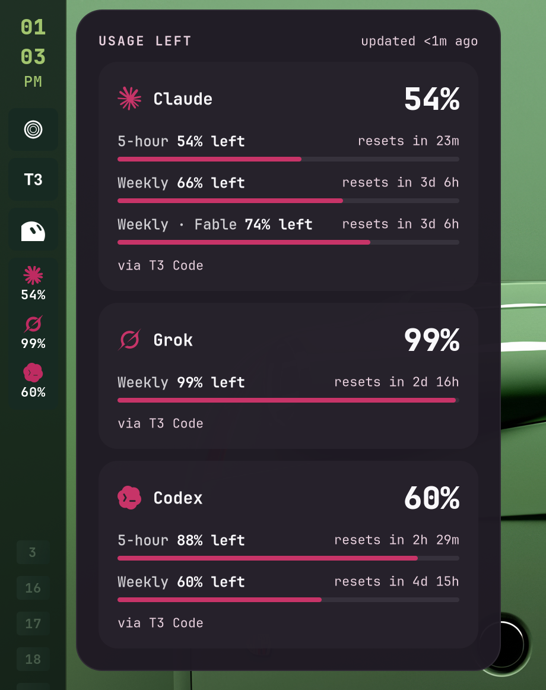
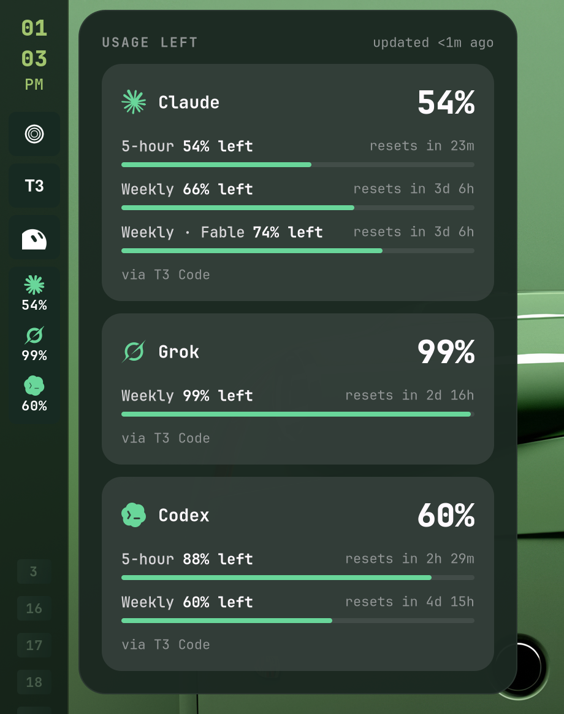
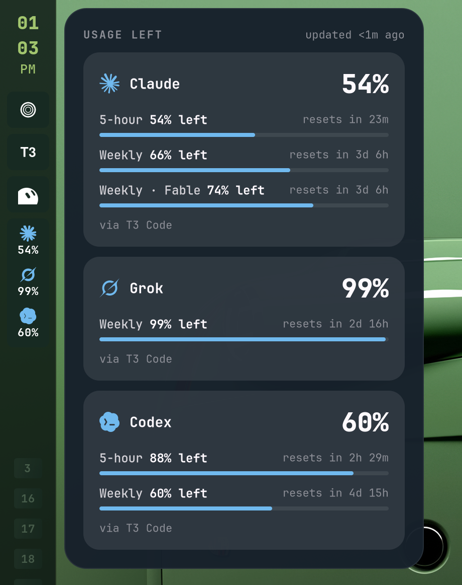
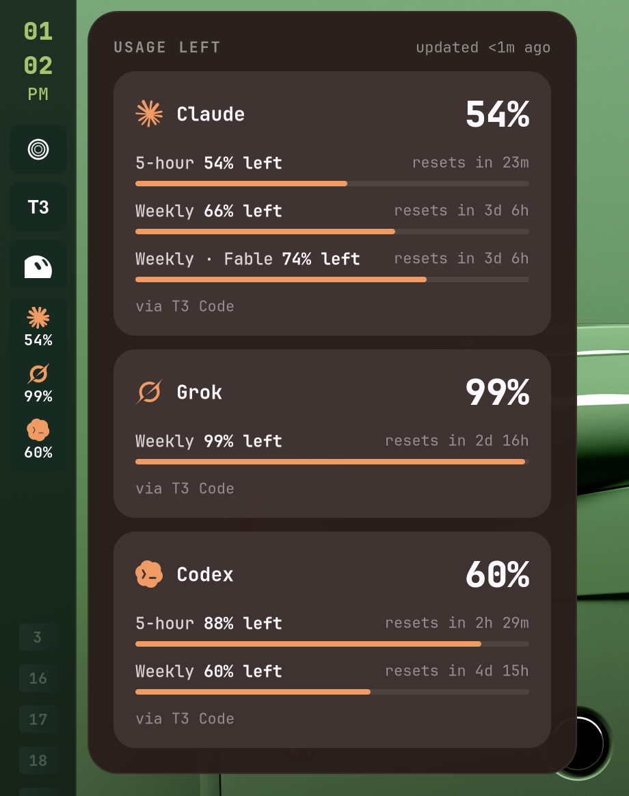
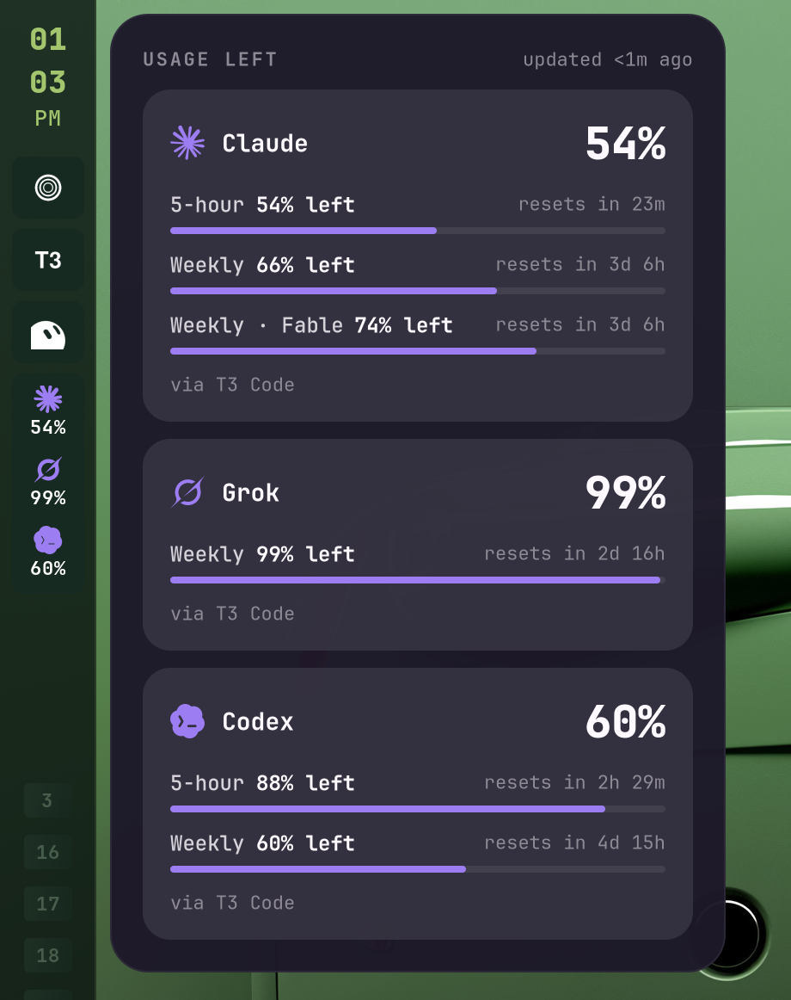
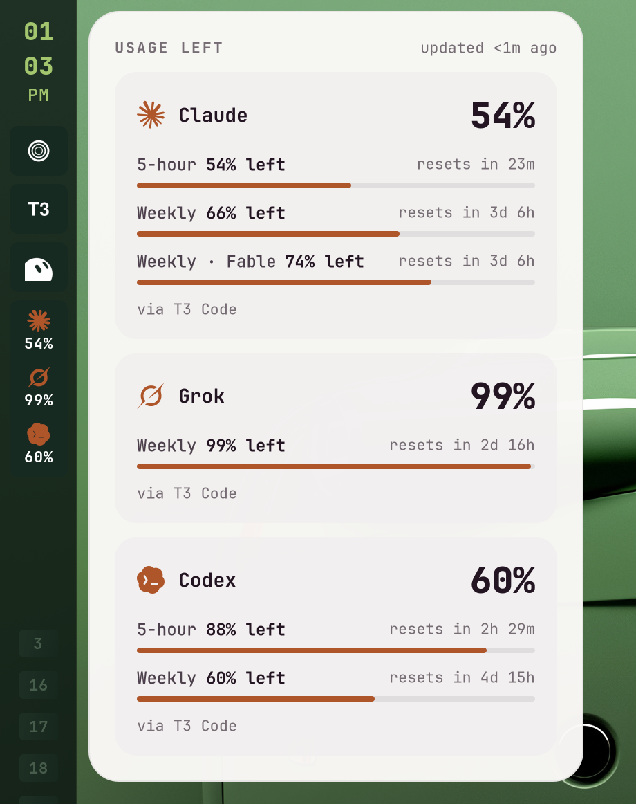
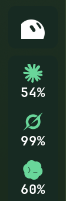

<div align="center">


# usage-plugin

**See how much of your AI subscriptions you have left, right in the Waybar you already have.**

Claude, Grok, Codex and more, read from [T3 Code](https://t3.codes) or straight from your CLI logins.
Hover the module for every window and when it resets.

**One module, every T3 Code theme.** Hover the module and the widget opens in whatever theme you picked in T3 Code:

<table>
  <tr>
    <td align="center"><br><b>T3 Chat</b> dark</td>
    <td align="center"><br><b>Grove</b> dark</td>
    <td align="center"><br><b>Ocean</b> dark</td>
  </tr>
  <tr>
    <td align="center"><br><b>Ember</b> dark</td>
    <td align="center"><br><b>Iris</b> dark</td>
    <td align="center"><br><b>Ember</b> light</td>
  </tr>
</table>


<sub>The same module in a horizontal bar.</sub>

</div>

## Contents

- [What you get](#what-you-get)
- [Requirements](#requirements)
- [Install](#install)
- [Add it to your bar](#add-it-to-your-bar)
- [Where readings come from](#where-readings-come-from)
- [Themes](#themes)
- [Configuration](#configuration)
- [Styling the module](#styling-the-module)
- [Troubleshooting](#troubleshooting)
- [Privacy and security](#privacy-and-security)
- [Add a provider](#add-a-provider)
- [Uninstall](#uninstall)
- [License](#license)

## What you get

- **One module, any bar.** Drop it into a vertical or horizontal Waybar. Your config is never rewritten. You paste one block.
- **The number that matters.** Each provider shows its logo and the percent left in its tightest window, the one closest to running out.
- **A widget on hover.** Rest the pointer on the module to see every window with its own bar and reset countdown. Click to pin it open.
- **Your T3 Code theme.** The logos, the warning colours and the widget all take their colours from the theme you picked in T3 Code, and they change when you switch it.
- **Two ways to read usage.** Connect to T3 Code, or use the CLI logins you already have for Claude and Grok.
- **Gentle on rate limits.** Every module and the widget share one cache, so there is one request per poll, however many modules you add.

## Requirements

| Needed for | What |
| --- | --- |
| Everything | Linux and [Waybar](https://github.com/Alexays/Waybar). The hover module is a Waybar CFFI module, tested on Waybar 0.16. |
| Building | [Bun](https://bun.sh). For the hover module, also `gcc`, `pkg-config` and the GTK 3 and json-glib headers. Without them you still get a click-only module. |
| The widget | `gjs`, `gtk4`, and `gtk4-layer-shell`, on a Wayland compositor with layer-shell, such as Hyprland, Sway, niri or river. |
| Readings | [T3 Code](https://t3.codes) running, or a `claude` or `grok` CLI login. |

**Hyprland is optional.** On Hyprland the widget opens level with your pointer, beside the bar you are pointing at. On other compositors it opens at the bar's edge, read from your Waybar config's `position`.

On Arch, the packages are:

```sh
sudo pacman -S --needed waybar gjs gtk4 gtk4-layer-shell gtk3 json-glib gcc pkgconf
```

## Install

**1. Get the code.**

```sh
git clone https://github.com/natyodev/usage-plugin.git
cd usage-plugin
```

**2. Run the installer.**

```sh
./install.sh
```

It builds the plugin and installs it for your user only:

| What | Where |
| --- | --- |
| The `usage-plugin` command | `~/.local/bin/usage-plugin`, a link into the folder below |
| The binary, the widget and the hover module | `~/.local/share/usage-plugin/` |
| The logo font | `~/.local/share/fonts/usage-plugin-icons.ttf`, then `fc-cache` |

It checks for `gjs` and `gtk4-layer-shell` and warns when either is missing, and it tells you where readings will come from. It never touches `~/.config/waybar/`. Running it again changes nothing unless the code changed, so it also updates an install after `git pull`.

The binary is about 104 MiB, because it carries the Bun runtime.

**3. Paste the module and reload Waybar.** The installer prints a block with your own paths. Add it to your Waybar config, put `"cffi/usage"` in one of your module lists, and reload:

```sh
pkill -SIGUSR2 waybar
```

## Add it to your bar

### Vertical bar



```jsonc
"modules-left": ["clock", "cffi/usage"],

"cffi/usage": {
  "module_path": "/home/YOU/.local/share/usage-plugin/usage-plugin-cffi.so",
  "exec": "/home/YOU/.local/bin/usage-plugin",
  "layout": "stacked",
  "interval": 30,
  "tooltip": false
}
```

Write full paths. The module runs `exec` without a shell, so `~` is not expanded.

### Horizontal bar

Use the same block with `"layout": "inline"`, which puts each logo beside its percent:

```jsonc
"cffi/usage": {
  "module_path": "/home/YOU/.local/share/usage-plugin/usage-plugin-cffi.so",
  "exec": "/home/YOU/.local/bin/usage-plugin",
  "layout": "inline",
  "interval": 30,
  "tooltip": false
}
```

### Module options

| Key | Default | Meaning |
| --- | --- | --- |
| `module_path` | required | The installed `usage-plugin-cffi.so`. Waybar reads this key itself. |
| `exec` | `usage-plugin` | The `usage-plugin` command, as a full path or a name on Waybar's `PATH`. |
| `layout` | `stacked` | `stacked` for a vertical bar, `inline` for a horizontal one. |
| `interval` | `30` | Seconds between updates of the module. Providers are still asked at most once per `pollIntervalSeconds`. |
| `hover-open-delay` | `150` | Milliseconds the pointer rests on the module before the widget opens. |
| `hover-close-delay` | `300` | Milliseconds you have to move from the module onto the widget before it closes. |
| `tooltip` | `true` | Set `false`, because the widget shows everything the tooltip would. |

Resting the pointer on the module opens the widget, and it stays open while the pointer is on the module or the widget. A click pins it until you press Escape, click outside it, or click the module again. An `on-click` of your own replaces the pin.

### Without the hover module

If the installer could not build the hover module, use a plain custom module. A click opens the widget, and the tooltip shows the same details:

```jsonc
"custom/usage": {
  "exec": "~/.local/bin/usage-plugin module --layout stacked",
  "return-type": "json",
  "interval": 30,
  "justify": "center",
  "on-click": "~/.local/bin/usage-plugin widget --toggle"
}
```

### One module per provider

To put each provider in its own place, add a custom module per provider with `--provider <id>`. The ids are `claude`, `grok`, `codex`, `cursor`, `antigravity` and `muse`. All of them share one cache, so splitting adds no requests. See [`examples/split.jsonc`](examples/split.jsonc).

```jsonc
"custom/usage-claude": {
  "exec": "~/.local/bin/usage-plugin module --provider claude --layout stacked",
  "return-type": "json",
  "interval": 30,
  "justify": "center",
  "on-click": "~/.local/bin/usage-plugin widget --toggle"
}
```

[`examples/`](examples) has complete [vertical](examples/vertical.jsonc), [horizontal](examples/horizontal.jsonc) and [split](examples/split.jsonc) configs, a [stylesheet](examples/style.css) and a [plugin config](examples/config.jsonc).

## Where readings come from

You choose with `source` in [the config file](#configuration).

### Connect to T3 Code (`"source": "auto"`, the default)

While T3 Code runs, the plugin asks T3's local server for the usage limits T3 already tracks. You need no other login, and you get every provider T3 shows, including Codex, Cursor, Antigravity and Muse. The numbers match T3's own usage panel. The tooltip and the widget say `via T3 Code`.

When T3 Code is closed, Claude and Grok fall back to your CLI logins, if you have them, and say `direct`. A provider with no fallback keeps its last reading, dimmed with `~`, and the tooltip says to open T3 Code. The plugin needs the `t3` command on your `PATH` or at `~/.local/bin/t3` to sign in to T3's server.

`"source": "t3"` reads only T3 Code and never calls a provider itself.

### Set up your own providers (`"source": "direct"`)

The plugin reads the logins your CLIs already store, and never contacts T3 Code:

| Provider | Sign in with | Login read from |
| --- | --- | --- |
| Claude | `claude` | `~/.claude/.credentials.json` |
| Grok | `grok` | `~/.grok/auth.json` |

When a login expires, the plugin keeps the last reading, dimmed, and tells you to run `claude` or `grok` again. It never refreshes a login itself. Grok's direct reading also splits the week into Chat and Build.

## Themes

With `"theme": "t3"` (the default), the plugin reads which theme you picked in T3 Code, in dark or light, and paints the module's logos, the warning and critical colours, and the whole widget from it. Switch themes in T3 Code and the bar and an open widget follow at their next update, without a restart. The [gallery at the top](#usage-plugin) shows the widget in each built-in theme.

Your own T3 Code themes work too, from T3's theme editor or from files in `~/.t3/userdata/themes/`.

- **The bar keeps your style.** Only the logos and the percent at warning or critical take theme colours. The bar's background, fonts and spacing stay yours. The colours are adjusted to stay readable on your bar's own background. Set `"barColors": false` to keep every logo and percent in your CSS colour, and the widget stays themed.
- **Translucency.** The widget follows T3 Code's glass opacity setting, from 88% to fully opaque. If your compositor blurs layer surfaces by namespace, the widget's namespace is `usage-plugin`.
- **Other theme modes.** `"theme": "waybar"` colours the widget from your Waybar `colors.css` when it defines `background`, `surface_container`, `on_background`, `muted`, `primary`, `amber` and `rust`. `"theme": "none"` leaves all colour to your CSS. The plugin also falls back to `waybar` by itself when it cannot read T3 Code's theme, for example with a T3 version it does not know yet.
- **Your own widget CSS.** `~/.config/usage-plugin/style.css` loads last, so it overrides any widget rule. Every widget colour is a `--usage-*` variable, such as `--usage-background`, `--usage-card`, `--usage-accent`, `--usage-warning` and `--usage-critical`.

## Configuration

The config file is optional. Create `~/.config/usage-plugin/config.jsonc` to change a default. Comments and trailing commas are allowed. A mistake never hides the module: it shows `⚠`, and its tooltip names the line and what is used instead.

```jsonc
{
  "source": "auto",
  "theme": "t3",
  "barColors": true,
  "providers": { "codex": false },
  "colors": { "claude": "#D97757" },
  "thresholds": { "warning": 75, "critical": 90 },
  "pollIntervalSeconds": 60,
  "notifications": true
}
```

| Key | Default | Meaning |
| --- | --- | --- |
| `source` | `"auto"` | `auto` reads T3 Code while it runs, else CLI logins. `t3` reads only T3 Code. `direct` reads only CLI logins. |
| `theme` | `"t3"` | `t3` follows your T3 Code theme. `waybar` uses Waybar's `colors.css`. `none` leaves colour to your CSS. |
| `barColors` | `true` | `false` keeps every logo and percent in the bar in your CSS colour. |
| `providers` | all on | `false` hides a provider, by id. |
| `colors` | none | A `#RGB` or `#RRGGBB` colour for one provider's logo, by id, over the theme. Use it for brand colours. |
| `thresholds` | `75`, `90` | Percent **used** at which a window turns `warning` and `critical`, so 25% and 10% left. |
| `pollIntervalSeconds` | `60` | How often providers are asked, from 60 to 3600 seconds. |
| `notifications` | `true` | One desktop notification when a window reaches critical, once per window per period. |

## Styling the module

The CFFI module's CSS id is `#cffi-usage`, a custom module's is `#custom-usage`, and a split module's is its own name, such as `#custom-usage-claude`. A `min-width` and `margin` keep the logos centred in a vertical bar:

```css
#cffi-usage { min-width: 42px; margin: 3px 7px; padding: 7px 0; }
#cffi-usage:hover { background: alpha(@on_background, 0.08); }
#cffi-usage.warning { color: @amber; }
#cffi-usage.critical { color: @rust; }
```

The module carries these classes:

| Class | When |
| --- | --- |
| `ok`, `warning`, `critical` | The level of the tightest window across the shown providers. |
| `claude`, `grok`, `codex`, ... | Each provider that is shown. |
| `claude-ok`, `claude-warning`, `claude-critical` | Each provider's own level. |
| `stale`, `claude-stale` | A reading kept from an earlier poll. |
| `waiting`, `claude-waiting` | A login exists, but no reading has arrived yet. |
| `expired`, `claude-expired` | The login expired and there is no earlier reading. |
| `broken`, `claude-broken` | The provider answered with something unreadable, or the module cannot run. |
| `t3-closed`, `t3-unsupported`, `t3-failing` | Nothing could be read because T3 Code is closed, too old, or failing. |
| `config-problem` | The config file has a mistake. |

And this is what each state looks like:

| You see | State | Meaning |
| --- | --- | --- |
| `54%` | fresh | The latest reading: percent left in the tightest window. |
| `~54%`, dimmed | stale | The last reading, kept because the latest poll could not run. The tooltip says why and how old it is. |
| `–`, dimmed | waiting | No reading yet, for example while rate limited. |
| `?` | expired | The login expired. Run `claude` or `grok` to sign in again. |
| `!` in red | broken | The provider's reply could not be read. It is never shown as a guessed number. |
| nothing | signed out | No login exists for that provider, so it is hidden. |

The logos are glyphs in the `usage-plugin-icons` font, so `color` themes them like text. Theme and `colors` colours are set on the text itself and win over CSS. Set `"barColors": false` for CSS to colour everything.

## Troubleshooting

Start with the debug report. It reads only the cache and never asks a provider:

```sh
usage-plugin module --debug
```

It shows the config file and any problems in it, the theme in use and why, each provider's last reading or miss, the line the module prints, and the latest log lines.

| Symptom | Fix |
| --- | --- |
| Boxes instead of logos | Run `fc-cache -f ~/.local/share/fonts` and reload Waybar. |
| The module is missing | Waybar may not find `module_path` or `exec`. Use full paths, and run Waybar from a terminal to see its warnings. |
| Hovering does nothing | Install `gjs`, `gtk4` and `gtk4-layer-shell`. Without them the module still shows usage. |
| A dimmed `–` and "open T3 Code" | T3 Code is closed and there is no CLI login to fall back to. Open T3 Code, or sign in with `claude` or `grok`. |
| Widget colours don't match T3 | `--debug` says why on its `theme` line, for example a T3 version the plugin does not know yet. |
| A provider shows `~` | Its last poll failed. The tooltip names the reason, such as a rate limit or no network. |

The cache, the log and the T3 token live in `$XDG_RUNTIME_DIR/usage-plugin/`, which is cleared at logout.

## Privacy and security

- **Logins are only read.** The plugin reads `~/.claude/.credentials.json` and `~/.grok/auth.json`, and never refreshes, rotates or writes them, so it can never sign you out of your CLI.
- **The T3 token is short-lived and narrow.** To read T3 Code, the plugin runs `t3 auth session issue --scope orchestration:read --ttl 1h`. That is T3's read-only scope, and the token lasts one hour. It is stored only in `$XDG_RUNTIME_DIR/usage-plugin/` at mode 0600, sent only to T3 on your own machine, and never printed or logged. When a new token replaces it, the old session is revoked.
- **Nothing is written to T3 Code or your CLIs.** The plugin writes nothing under `~/.t3/userdata/`, `~/.config/t3code-v2/`, `~/.claude/` or `~/.grok/`. It reads T3's theme from its settings files and never changes them.
- **Requests.** In `direct` mode, the plugin calls Claude's and Grok's usage endpoints, with the token in a header and never in the URL. Grok's endpoint is the one its CLI's `/usage` uses, and it is undocumented, so a change there shows Grok as broken, never as a wrong number.

## Add a provider

A provider that T3 Code reports needs only a logo and a registry row. Reading it without T3 needs one adapter file as well.

1. Add a one-colour SVG logo as `assets/logos/<id>.svg`. The build rejects a logo with its own colours, because the bar's CSS paints it.
2. Add a row to the table in `src/providers/index.ts`. Take the next free glyph and never reuse one:

   ```ts
   example: { glyph: 0xe907, name: "Example", loginCommand: "example", t3Driver: "example", fetch: fetchExample },
   ```

   `t3Driver` is the driver name T3 Code reports, or `null`. Leave out `fetch` for a provider read only through T3.
3. For a direct reading, write `src/providers/<id>.ts` exporting a `FetchWindows` function. Read the login with `ctx.readLogin`, call the provider with `ctx.get`, and return `{ kind: "windows", windows, plan }`, where each window is `{ label, usedPercent, resetsAt, detail: [] }`. The rules above `FetchWindows` in `src/providers/index.ts` cover misses and tokens.
4. Record a reply as `test/fixtures/<case>/<id>.json` and its login under `test/fixtures/<case>/home/`, then try it without the network:

   ```sh
   bun run build
   USAGE_PLUGIN_FIXTURES=test/fixtures/<case> ./dist/usage-plugin module --debug
   ```

5. Run `bun run check`.

## Uninstall

```sh
rm -r ~/.local/share/usage-plugin ~/.local/bin/usage-plugin ~/.local/share/fonts/usage-plugin-icons.ttf
rm -rf ~/.config/usage-plugin
fc-cache -f ~/.local/share/fonts
```

Then remove the module from your Waybar config and reload Waybar. If you used T3 Code, any plugin session left in T3's list of connected clients expires within the hour.

## License

MIT. See [LICENSE](LICENSE). The provider logos come from [LobeHub Icons](https://github.com/lobehub/lobe-icons) under MIT, as recorded in [`assets/logos/NOTICE`](assets/logos/NOTICE), and remain trademarks of their owners.

Built with [T3 Code](https://t3.codes).
